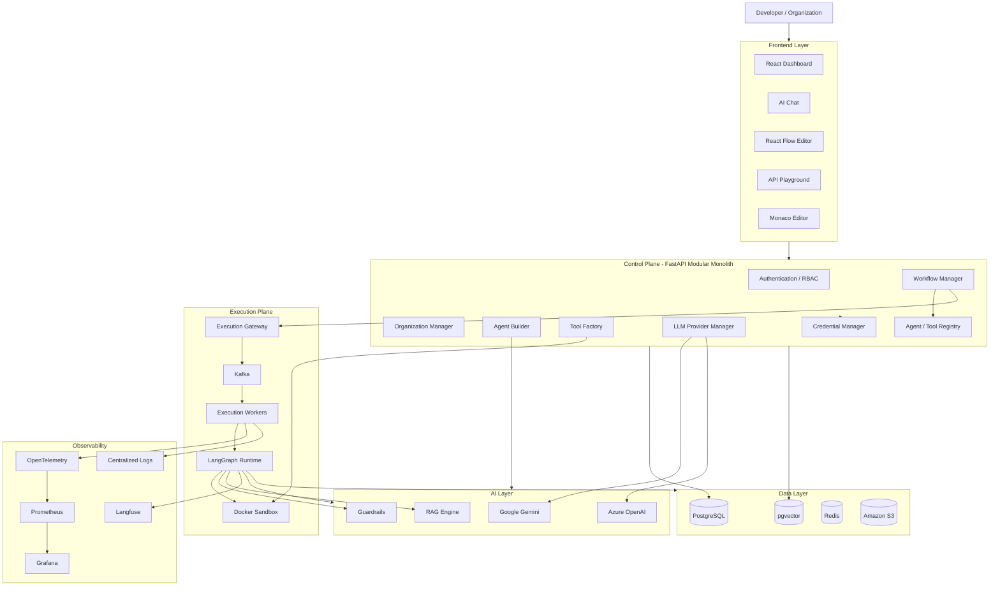
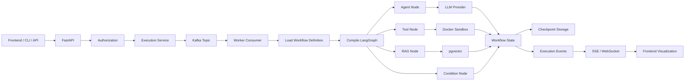
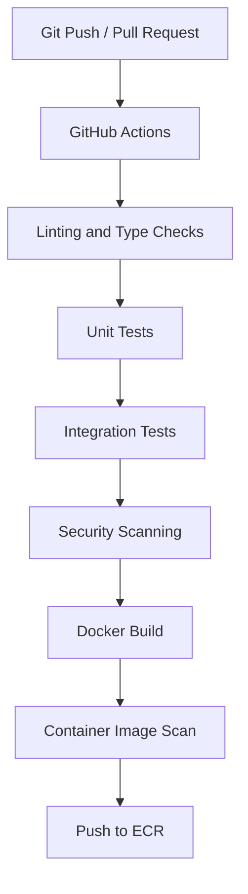
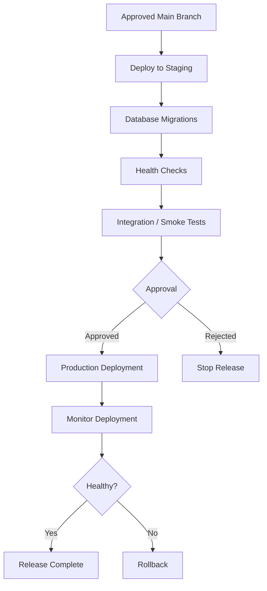

# AgentForge AI
## Production-Ready Agent Development, Orchestration & AgentOps Platform

**Project Type:** Multi-Tenant SaaS Platform  
**Architecture:** Modular Monolith + Distributed Workers  
**Backend:** Python, FastAPI  
**Frontend:** React, TypeScript  
**Agent Framework:** LangGraph + LangChain  
**Workflow Engine:** React Flow + LangGraph  
**LLM Providers:** Google Gemini + Azure OpenAI  
**Database:** PostgreSQL + pgvector  
**Event Streaming:** Apache Kafka  
**Cache:** Redis  
**Code Execution:** Isolated Docker Sandbox  
**Cloud:** AWS ECS → AWS EKS  
**CI/CD:** GitHub Actions  
**Infrastructure:** Terraform  

---

# 1. Project Overview

AgentForge AI is a production-oriented Agent Development and Operations Platform that enables developers and organizations to create, configure, test, orchestrate, deploy and monitor AI agents and Python tools.

The platform provides a unified development environment where users can:

1. Create AI agents using natural language or manual configuration.
2. Generate Python tools using Generative AI.
3. Visually construct multi-agent workflows.
4. Execute workflows through an AI chat interface.
5. Test agents, tools and REST APIs through an integrated playground.
6. Manage LLM provider credentials using Bring Your Own API Key (BYOK).
7. Execute generated Python code in isolated Docker environments.
8. Manage agent and tool versions.
9. Monitor executions, logs, latency, tokens and costs.
10. Deploy workflows and agents to AWS.
11. Scale execution workers independently.
12. Manage multiple organizations, users, roles and permissions.

## 1.1 Core Product Vision

Build a platform where developers can describe what they want in natural language and AgentForge AI generates the necessary agents, tools and workflow configurations.

The generated components should be editable, testable, version-controlled and deployable.

The platform must support both AI-assisted development and traditional developer-controlled configuration.

## 1.2 Primary Users

- AI Engineers
- Agentic AI Developers
- Backend Developers
- DevOps Engineers
- SRE Engineers
- Platform Engineers
- Enterprise Development Teams

---

# 2. Core Functional Modules

## 2.1 Organization and Tenant Management

Support multiple organizations using the same platform infrastructure.

Each organization has isolated:

- Users
- Agents
- Tools
- Workflows
- Documents
- LLM provider configurations
- Credentials
- Execution history
- Deployments
- Monitoring information

Organization roles:

| Role | Permissions |
|---|---|
| Organization Owner | Complete organization administration |
| Admin | Manage users, resources and configurations |
| Developer | Create and modify agents, tools and workflows |
| Operator | Execute workflows and manage approved deployments |
| Viewer | Read-only access |

Implement role-based access control (RBAC) and organization-level resource isolation.

All organization-owned database records must have an organization identifier.

## 2.2 LLM Provider Manager — BYOK

This is a core module.

Users should be able to configure their own LLM provider credentials.

Supported providers:

- Google Gemini
- Azure OpenAI

### Provider activation lifecycle

1. User opens LLM Settings.
2. Selects Gemini or Azure OpenAI.
3. Enters the required API credentials.
4. Provides any additional provider configuration.
5. Backend validates the credentials.
6. Platform tests connectivity.
7. Available models are retrieved or configured.
8. User selects a default model.
9. Provider is activated for the organization.
10. Agents can now use the activated provider.

### Gemini configuration

Required:
- Gemini API key.

Optional:
- Default model.
- Provider-specific settings.

### Azure OpenAI configuration

Required:
- Azure OpenAI API key.
- Endpoint.
- Deployment name.
- API version.

### Provider interface

Implement a common provider abstraction:

```python
class BaseLLMProvider:

    async def validate_credentials(self):
        pass

    async def list_models(self):
        pass

    async def generate(self, messages):
        pass

    async def stream(self, messages):
        pass

    async def get_usage(self):
        pass
```

Implement:

```text
GeminiProvider
AzureOpenAIProvider
```

Use LangChain model integrations behind the provider abstraction where practical.

### Credential security

- Never store API keys as plaintext.
- Encrypt credentials using AWS KMS-backed encryption.
- Store encrypted values in a dedicated credential store or encrypted secret records.
- Use AWS Secrets Manager for production secret storage.
- Use references rather than actual secrets in agent configurations.
- Mask credentials in the frontend.
- Never expose secrets through APIs, logs or execution traces.
- Allow users to test, activate, deactivate and rotate credentials.

Provider activation must be organization-scoped and permission-controlled.

A provider connection is not automatically available to every organization user. Users must have permission to use the organization connection.

## 2.3 AI Agent Builder

Two creation modes:

### Natural Language Builder

Example:

"Create an SRE agent that monitors Kubernetes pods, analyzes application logs, retrieves relevant incidents and generates troubleshooting reports."

The AI builder generates:

- Agent metadata.
- System instructions.
- Model configuration.
- Tool requirements.
- Input schema.
- Output schema.
- Memory configuration.
- Guardrail configuration.
- LangGraph configuration.

The user must review and approve the generated definition before publishing.

### Manual Agent Builder

Configuration:

| Field | Description |
|---|---|
| Agent Name | Unique agent name |
| Description | Agent purpose |
| LLM Provider | Gemini / Azure OpenAI |
| Model | Selected model |
| Instructions | System prompt |
| Tools | Registered tools |
| Memory | Conversation or persistent memory |
| Retry Policy | Maximum retry attempts |
| Timeout | Execution timeout |
| Guardrails | Input/output policies |
| Version | Agent version |

### Agent Lifecycle

```text
DRAFT
  |
  v
CONFIGURED
  |
  v
TESTING
  |
  v
APPROVED
  |
  v
PUBLISHED
  |
  v
DEPLOYED
  |
  v
MONITORING
```

Support agent versioning and rollback.

## 2.4 GenAI Tool Factory

Generate reusable Python tools through natural language.

Example request:

"Create a Python tool that retrieves failed transactions from PostgreSQL and returns the results as JSON."

Generated artifacts:

- Python source code.
- Pydantic input schema.
- Output schema.
- requirements.txt.
- Unit tests.
- Documentation.
- Tool metadata.

### Tool lifecycle

```text
User Prompt
    |
    v
LLM Code Generation
    |
    v
Python Code
    |
    v
Static Code Analysis
    |
    v
Dependency Validation
    |
    v
Sandbox Execution
    |
    v
Unit Testing
    |
    v
Developer Approval
    |
    v
Tool Registry
    |
    v
Available to Agents
```

### Tool execution security

Generated Python code must never execute directly inside the FastAPI process.

Use isolated Docker containers with:

- Non-root execution.
- CPU limits.
- Memory limits.
- Execution timeouts.
- Restricted filesystem access.
- Network restrictions.
- Approved dependencies.
- Container cleanup after execution.

Use a separate sandbox service and worker pool.

## 2.5 Visual Workflow Studio

Use React Flow (`@xyflow/react`) for the workflow canvas.

Users should be able to:

- Drag and drop nodes.
- Connect nodes.
- Configure individual nodes.
- Add conditions.
- Create loops.
- Connect agents and tools.
- Validate workflows.
- Execute workflows.
- Inspect execution status.
- Save workflow versions.

### Supported node types

| Node | Description |
|---|---|
| Start Node | Workflow entry |
| Agent Node | Execute an AI agent |
| Tool Node | Execute Python tools |
| LLM Node | Direct LLM invocation |
| RAG Node | Vector retrieval |
| API Node | REST API execution |
| Condition Node | Branching logic |
| Loop Node | Iterative execution |
| Kafka Node | Event publishing/consumption |
| Human Approval Node | Manual approval |
| Delay Node | Scheduled continuation |
| End Node | Workflow completion |

### Workflow compilation

React Flow is responsible for visual editing, not workflow execution.

The backend must:

1. Receive the workflow JSON.
2. Validate its structure.
3. Validate node connections.
4. Check permissions.
5. Validate referenced agent and tool versions.
6. Build the LangGraph execution graph.
7. Execute the graph through the runtime.
8. Publish execution events.
9. Update the frontend through SSE or WebSockets.

### Workflow definition example

```json
{
  "workflow_id": "incident-workflow",
  "version": 1,
  "nodes": [
    {
      "id": "start",
      "type": "trigger"
    },
    {
      "id": "agent-1",
      "type": "agent",
      "config": {
        "agent_id": "incident-agent",
        "version": "1.0"
      }
    },
    {
      "id": "tool-1",
      "type": "tool",
      "config": {
        "tool_id": "prometheus-query",
        "version": "1.0"
      }
    },
    {
      "id": "end",
      "type": "output"
    }
  ],
  "edges": [
    {
      "source": "start",
      "target": "agent-1"
    },
    {
      "source": "agent-1",
      "target": "tool-1"
    },
    {
      "source": "tool-1",
      "target": "end"
    }
  ]
}
```

The JSON above is a simplified example. Production definitions must also include validated schemas, configuration references, execution policies and version information.

## 2.6 AI Chat Interface

The chat interface is the main execution interface.

Example:

User:
"Execute the Kubernetes monitoring workflow."

Platform:

- Identifies the workflow.
- Validates user permissions.
- Creates an execution.
- Starts the workflow.
- Streams execution updates.
- Displays results.

Features:

- Conversation history.
- Agent selection.
- Workflow selection.
- Streaming responses.
- Tool execution visibility.
- Human approval.
- File uploads.
- Execution history.
- Error explanations.

The chat layer must use authorized agent and workflow references. It must not have unrestricted access to registered tools.

## 2.7 API Playground and Code Editor

Build an integrated API testing environment.

Use Monaco Editor for code editing.

Features:

- GET, POST, PUT, PATCH, DELETE.
- Request headers.
- Authentication.
- Query parameters.
- JSON request body.
- JSON response viewer.
- HTTP status.
- Response duration.
- Python code snippets.
- curl generation.
- API documentation.

Example:

```http
POST /api/v1/agents/{agent_id}/execute
```

Request:

```json
{
  "input": {
    "namespace": "payments"
  },
  "stream": true
}
```

The playground should support both internal platform APIs and explicitly authorized external API testing.

## 2.8 Agent and Tool Registry

Central registry for reusable resources.

Maintain:

- Agent metadata.
- Tool metadata.
- Versions.
- Source definitions.
- Input/output schemas.
- Dependencies.
- Owners.
- Permissions.
- Publication status.
- Deployment references.

Support:

- Create.
- Clone.
- Publish.
- Archive.
- Version.
- Rollback.
- Search.
- Filter.

## 2.9 CLI

Build the CLI using Python Typer.

Example commands:

```bash
# Initialize
agentforge init my-project

# Create an agent
agentforge agent create incident-agent

# Generate agent using GenAI
agentforge agent generate \
  --prompt "Create a Kubernetes monitoring agent"

# Generate a tool
agentforge tool generate \
  --prompt "Create a PostgreSQL query tool"

# List agents
agentforge agent list

# Test agent
agentforge agent test incident-agent

# List workflows
agentforge workflow list

# Execute workflow
agentforge workflow run incident-workflow

# Check logs
agentforge logs incident-agent

# Deploy
agentforge deploy incident-agent --env staging

# Check deployment
agentforge status
```

The CLI communicates with the authenticated FastAPI backend.

---

# 3. System Architecture

## 3.1 Architectural Approach

Use a modular monolith for the control plane and independent workers for execution.

Do not start with a large number of microservices.

### Control Plane

Responsible for:

- Authentication.
- Organization management.
- Agent creation.
- Tool generation.
- Workflow management.
- Registry.
- LLM configuration.
- Credential management.
- Deployment management.
- API management.

### Data Plane

Responsible for:

- Agent execution.
- Workflow execution.
- Tool execution.
- LLM invocation.
- RAG retrieval.
- Background jobs.
- Event processing.

The data plane must be independently scalable.

## 3.2 High-Level Architecture Diagram



## 3.3 Main Execution Workflow Diagram

This diagram represents the central AgentForge AI user journey.

```mermaid
flowchart TD

    A([Developer Opens AgentForge]) --> B[Login / Select Organization]

    B --> C{LLM Provider Configured?}

    C -->|No| D[Configure Gemini / Azure OpenAI]
    D --> E[Enter API Credentials]
    E --> F[Validate API Key and Connection]
    F --> G{Valid Credentials?}

    G -->|No| E
    G -->|Yes| H[Activate Provider]

    C -->|Yes| H

    H --> I{Choose Creation Method}

    I -->|Agent| J[AI Agent Builder]
    I -->|Tool| K[GenAI Tool Factory]
    I -->|Workflow| L[Workflow Studio]

    J --> M[Generate Agent Definition]
    M --> N[Configure Prompt, Model and Tools]

    K --> O[Generate Python Code]
    O --> P[Static Analysis and Dependency Checks]
    P --> Q[Execute in Docker Sandbox]
    Q --> R[Validate and Publish Tool]

    N --> S[Save Agent Version]
    R --> T[Register Tool]

    S --> U[Workflow Studio]
    T --> U
    L --> U

    U --> V[Connect Agents, Tools and Nodes]
    V --> W[Validate Workflow]
    W --> X{Validation Successful?}

    X -->|No| V
    X -->|Yes| Y[Save Workflow Version]

    Y --> Z[Publish Workflow]
    Z --> AA[Deploy / Activate Runtime]

    AA --> AB([Execute Through Chat, API or CLI])

    AB --> AC[Authentication and Permission Check]
    AC --> AD[Create Execution ID]
    AD --> AE[Kafka Execution Event]
    AE --> AF[Execution Worker]
    AF --> AG[LangGraph Orchestrator]

    AG --> AH[Execute Agents and Tools]
    AH --> AI[Guardrail Validation]
    AI --> AJ[Store Results and Checkpoints]

    AJ --> AK[Stream Execution Events]
    AK --> AL[Chat and Workflow Visualization]

    AJ --> AM[Logs, Metrics and Traces]
    AM --> AN[Monitoring Dashboard]

    AL --> AO([Execution Completed])
```



## 3.4 Workflow Execution Architecture



---

# 4. Technology Stack

| Layer | Technology |
|---|---|
| Frontend | React.js, TypeScript |
| Styling | Tailwind CSS |
| Workflow Editor | React Flow |
| Code Editor | Monaco Editor |
| Backend | Python FastAPI |
| Agent Framework | LangGraph |
| LLM Integration | LangChain |
| LLM Providers | Gemini, Azure OpenAI |
| Data Validation | Pydantic |
| ORM | SQLAlchemy |
| Migrations | Alembic |
| Database | PostgreSQL |
| Vector Search | pgvector |
| Cache | Redis |
| Event Streaming | Apache Kafka |
| Background Execution | Python Workers |
| Code Sandbox | Docker |
| CLI | Typer |
| Authentication | JWT / OAuth2 / OIDC |
| Authorization | RBAC |
| Secrets | AWS Secrets Manager |
| Encryption | AWS KMS |
| Object Storage | Amazon S3 |
| Containers | Docker |
| Initial Deployment | AWS ECS Fargate |
| Advanced Deployment | AWS EKS |
| Registry | Amazon ECR |
| Infrastructure as Code | Terraform |
| CI/CD | GitHub Actions |
| Metrics | Prometheus |
| Dashboards | Grafana |
| Logging | CloudWatch / Loki |
| Tracing | OpenTelemetry |
| LLM Observability | Langfuse |
| Load Testing | Locust / k6 |

---

# 5. Database Architecture

PostgreSQL is the primary transactional database.

pgvector provides vector search capabilities within PostgreSQL.

## 5.1 Database Tables

### Identity and Multi-Tenancy

| Table | Important Columns |
|---|---|
| organizations | id, name, slug, status |
| users | id, email, password_hash, status |
| memberships | id, organization_id, user_id, role_id |
| roles | id, organization_id, name |
| permissions | id, permission_key |
| role_permissions | role_id, permission_id |
| invitations | id, organization_id, email, token_hash, expires_at |

### Agent Management

| Table | Important Columns |
|---|---|
| agents | id, organization_id, name, description, status |
| agent_versions | id, agent_id, version, configuration_json |
| agent_tools | id, agent_version_id, tool_version_id |
| agent_evaluations | id, agent_version_id, score, results_json |

### Tool Management

| Table | Important Columns |
|---|---|
| tools | id, organization_id, name, description |
| tool_versions | id, tool_id, version, source_code, schema_json |
| tool_dependencies | id, tool_version_id, package_name, version |
| tool_tests | id, tool_version_id, test_results, status |

### Workflow Management

| Table | Important Columns |
|---|---|
| workflows | id, organization_id, name, status |
| workflow_versions | id, workflow_id, version, definition_json |
| workflow_nodes | id, workflow_version_id, node_id, type, config_json |
| workflow_edges | id, workflow_version_id, source_node, target_node |

### Execution Management

| Table | Important Columns |
|---|---|
| executions | id, organization_id, workflow_version_id, status |
| execution_events | id, execution_id, event_type, payload_json |
| execution_checkpoints | id, execution_id, checkpoint_reference |
| execution_artifacts | id, execution_id, s3_object_key |
| worker_jobs | id, execution_id, status, attempts |

### LLM and Credentials

| Table | Important Columns |
|---|---|
| llm_providers | id, organization_id, provider_type, status |
| llm_models | id, provider_id, model_name, configuration_json |
| credentials | id, organization_id, provider_id, secret_reference |
| usage_records | id, organization_id, execution_id, tokens, estimated_cost |

### Chat and RAG

| Table | Important Columns |
|---|---|
| chat_sessions | id, organization_id, user_id |
| chat_messages | id, session_id, role, content |
| documents | id, organization_id, filename, s3_key |
| document_chunks | id, document_id, chunk_text, embedding |

The document embedding column should use the pgvector vector type with an explicitly selected embedding dimension.

### Deployment and Audit

| Table | Important Columns |
|---|---|
| deployments | id, organization_id, resource_id, environment, status |
| deployment_versions | id, deployment_id, version, configuration_json |
| audit_logs | id, organization_id, actor_id, action, resource_id |
| api_keys | id, organization_id, user_id, key_hash, status |

## 5.2 Multi-Tenant Data Isolation

Every organization-owned table must include:

```sql
organization_id UUID NOT NULL
```

Use:

- Organization-scoped database queries.
- PostgreSQL Row-Level Security.
- Composite foreign keys where appropriate.
- Organization-level API authorization.
- Organization-scoped object storage paths.
- Organization-scoped vector search filters.

Example:

```sql
CREATE TABLE agents (
    id UUID PRIMARY KEY,
    organization_id UUID NOT NULL
        REFERENCES organizations(id),
    name VARCHAR(255) NOT NULL,
    description TEXT,
    status VARCHAR(30) NOT NULL,
    created_at TIMESTAMPTZ DEFAULT NOW(),
    UNIQUE (organization_id, id)
);
```

Application queries must always apply organization filters.

RLS policies must be designed to fail closed and tested against connection pooling and transaction context reuse.

---

# 6. API Architecture and Contracts

Base URL:

```text
/api/v1
```

All protected API operations require authentication and organization-level authorization.

## 6.1 Authentication

```http
POST /auth/register
POST /auth/login
POST /auth/refresh
POST /auth/logout
GET  /auth/me
```

## 6.2 Organization Management

```http
POST   /organizations
GET    /organizations
GET    /organizations/{organization_id}
PUT    /organizations/{organization_id}
POST   /organizations/{organization_id}/members
DELETE /organizations/{organization_id}/members/{user_id}
```

## 6.3 LLM Provider Management

```http
GET    /llm/providers
POST   /llm/providers/connect
POST   /llm/providers/{provider_id}/validate
GET    /llm/providers/{provider_id}/models
POST   /llm/providers/{provider_id}/activate
POST   /llm/providers/{provider_id}/deactivate
DELETE /llm/providers/{provider_id}
```

Example:

```json
{
  "provider": "gemini",
  "api_key": "USER_SUPPLIED_KEY",
  "default_model": "configured-model"
}
```

The backend must immediately validate and securely store the supplied credential. Never return the API key in the response.

Response:

```json
{
  "provider_id": "provider-123",
  "provider": "gemini",
  "status": "active",
  "default_model": "configured-model"
}
```

## 6.4 Agent APIs

```http
POST /agents
GET  /agents
GET  /agents/{agent_id}
PUT  /agents/{agent_id}
POST /agents/generate
POST /agents/{agent_id}/test
POST /agents/{agent_id}/publish
GET  /agents/{agent_id}/versions
POST /agents/{agent_id}/rollback
```

## 6.5 Tool APIs

```http
POST /tools/generate
POST /tools
GET  /tools
GET  /tools/{tool_id}
POST /tools/{tool_id}/test
POST /tools/{tool_id}/publish
GET  /tools/{tool_id}/versions
```

## 6.6 Workflow APIs

```http
POST /workflows
GET  /workflows
GET  /workflows/{workflow_id}
PUT  /workflows/{workflow_id}
POST /workflows/{workflow_id}/validate
POST /workflows/{workflow_id}/publish
POST /workflows/{workflow_id}/execute
GET  /workflows/{workflow_id}/versions
```

## 6.7 Execution APIs

```http
POST /executions
GET  /executions
GET  /executions/{execution_id}
GET  /executions/{execution_id}/events
GET  /executions/{execution_id}/logs
POST /executions/{execution_id}/cancel
POST /executions/{execution_id}/resume
```

## 6.8 Secrets APIs

```http
POST   /credentials
GET    /credentials
POST   /credentials/{credential_id}/validate
POST   /credentials/{credential_id}/rotate
DELETE /credentials/{credential_id}
```

Never expose decrypted credentials through these endpoints.

## 6.9 Deployment APIs

```http
POST /deployments
GET  /deployments
GET  /deployments/{deployment_id}
POST /deployments/{deployment_id}/rollback
POST /deployments/{deployment_id}/scale
```

## 6.10 Monitoring APIs

```http
GET /monitoring/health
GET /monitoring/metrics
GET /monitoring/executions
GET /monitoring/agents
GET /monitoring/usage
GET /monitoring/costs
```

---

# 7. Kafka Architecture

Kafka handles asynchronous execution and event distribution.

## 7.1 Topics

| Topic | Purpose |
|---|---|
| agent.execution.requested | New execution |
| agent.execution.started | Execution started |
| agent.execution.completed | Successful completion |
| agent.execution.failed | Execution failure |
| workflow.execution.events | Workflow events |
| tool.execution.events | Tool execution |
| security.audit.events | Security auditing |
| deployment.events | Deployment lifecycle |

## 7.2 Event Example

```json
{
  "event_id": "event-123",
  "event_type": "agent.execution.requested",
  "organization_id": "org-123",
  "execution_id": "exec-123",
  "resource_id": "agent-123",
  "resource_version": "1.0",
  "timestamp": "2026-11-13T10:00:00Z"
}
```

## 7.3 Reliability Requirements

Implement:

- Consumer groups.
- Idempotent processing.
- Retry policies.
- Dead-letter topics.
- Correlation IDs.
- Event schema versioning.
- Execution timeouts.
- Backpressure.
- Outbox pattern for reliable database-to-Kafka event publication.

Kafka is not the source of truth for workflow state. PostgreSQL and LangGraph checkpoint storage maintain durable execution state.

---

# 8. Security Architecture

Security must be implemented at every layer.

## 8.1 Authentication

- JWT-based authentication or OIDC.
- Secure refresh token handling.
- Password hashing using Argon2id if local passwords are supported.
- Session expiration.
- Optional MFA.

## 8.2 Authorization

- RBAC.
- Organization-level authorization.
- Resource-level permissions.
- Tool-level authorization.
- Environment-level deployment permissions.

## 8.3 LLM Credential Security

- BYOK.
- AWS Secrets Manager.
- AWS KMS encryption.
- IAM roles.
- Secret rotation.
- Credential masking.
- Access audit records.
- No secrets in prompts, generated code or logs.

## 8.4 Python Sandbox Security

- Isolated Docker containers.
- Non-root execution.
- Read-only root filesystem.
- Resource limits.
- Restricted network access.
- Execution timeout.
- Approved dependency allowlist.
- Image scanning.
- No Docker socket access.
- No unrestricted host mounts.

Treat generated code and tool outputs as untrusted data.

## 8.5 AI Guardrails

Implement:

- Input validation.
- Prompt injection detection.
- Output schema validation.
- PII detection.
- Sensitive data redaction.
- Tool permission validation.
- Rate limiting.
- Human approval for sensitive actions.
- Model usage limits.
- Organization-level execution quotas.

Use deterministic policies alongside model-based guardrail checks.

## 8.6 Audit Logging

Log:

- Login events.
- Organization membership changes.
- Credential creation and rotation.
- Agent publication.
- Tool publication.
- Workflow execution.
- Deployment operations.
- Permission changes.
- Administrative actions.

Never record raw API keys, passwords or unredacted secrets in audit events.

---

# 9. Observability and Monitoring

Implement centralized monitoring for infrastructure, agents and workflows.

## 9.1 Infrastructure Monitoring

Prometheus:

- CPU.
- Memory.
- Disk.
- API latency.
- Request throughput.
- Worker utilization.
- Kafka consumer lag.
- Database connections.
- Container health.

Grafana:

- Platform dashboard.
- API dashboard.
- Kafka dashboard.
- Worker dashboard.
- Database dashboard.
- AWS infrastructure dashboard.

## 9.2 Logging

Use structured JSON logs.

Example:

```json
{
  "timestamp": "2026-11-13T10:00:00Z",
  "level": "INFO",
  "organization_id": "org-123",
  "execution_id": "exec-123",
  "agent": "incident-agent",
  "event": "tool_execution_completed",
  "duration_ms": 350
}
```

Never log credentials or sensitive user content without an explicit and secure data-handling policy.

## 9.3 LLM Observability

Use Langfuse and OpenTelemetry.

Track:

- LLM request count.
- Input tokens.
- Output tokens.
- Model cost.
- Latency.
- Agent execution time.
- Tool execution time.
- Prompt version.
- Retrieval relevance.
- Workflow completion rate.
- Retry count.
- Evaluation scores.

## 9.4 Guardrail Dashboard

Track:

- Prompt injection attempts.
- Blocked tool calls.
- Invalid output schemas.
- PII detections.
- Unauthorized access attempts.
- Rate-limit violations.
- Sandbox policy violations.
- Human approval decisions.

---

# 10. AWS Deployment Architecture

## 10.1 Phase 1 — ECS Fargate

Deploy the initial production version using:

| AWS Service | Purpose |
|---|---|
| ECS Fargate | Container execution |
| ECR | Docker image registry |
| ALB | Application load balancing |
| RDS PostgreSQL | Main database |
| S3 | Documents and artifacts |
| Secrets Manager | Credentials |
| KMS | Encryption |
| ElastiCache Redis | Caching |
| CloudWatch | AWS monitoring |
| IAM | Permissions |
| VPC | Network isolation |

Kafka can initially run in a controlled development environment. Use Amazon MSK for a production managed Kafka deployment when needed.

## 10.2 Phase 2 — EKS

Introduce EKS when the platform requires more advanced runtime orchestration.

Features:

- Horizontal Pod Autoscaling.
- Worker autoscaling.
- Karpenter or Cluster Autoscaler.
- Kubernetes Jobs for isolated execution.
- Deployment rollouts.
- Pod health checks.
- Resource quotas.
- Network policies.
- Service accounts with IAM roles.

## 10.3 Scaling Strategy

Scale the control plane and execution plane independently.

Control plane:
- Horizontal API scaling.
- ALB distribution.
- Database connection pooling.
- Redis caching.

Execution plane:
- Worker replicas.
- Kafka consumer groups.
- Queue lag-based scaling.
- CPU/memory-based scaling.
- Per-organization quotas.

Do not create a separate permanent server for each agent.

Use shared runtime workers with per-execution isolation and resource limits.

---

# 11. CI/CD Pipeline

Use GitHub Actions.

## 11.1 CI Workflow



## 11.2 CD Workflow



Requirements:

- Automated tests.
- Docker image versioning.
- Vulnerability scanning.
- Infrastructure validation.
- Environment-specific configuration.
- Approval before production.
- Deployment health checks.
- Rollback support.

Use GitHub OIDC with AWS IAM roles instead of storing long-lived AWS credentials in GitHub secrets.

---

# 12. Project Folder Structure

Use a monorepo.

```text
agentforge-ai/
│
├── frontend/
│   ├── public/
│   ├── src/
│   │   ├── app/
│   │   ├── components/
│   │   ├── pages/
│   │   ├── layouts/
│   │   ├── features/
│   │   │   ├── authentication/
│   │   │   ├── organizations/
│   │   │   ├── agents/
│   │   │   ├── tools/
│   │   │   ├── workflows/
│   │   │   ├── chat/
│   │   │   ├── playground/
│   │   │   ├── credentials/
│   │   │   ├── deployments/
│   │   │   └── monitoring/
│   │   ├── hooks/
│   │   ├── services/
│   │   └── types/
│   └── package.json
│
├── backend/
│   ├── app/
│   │   ├── main.py
│   │   ├── api/
│   │   │   └── v1/
│   │   ├── core/
│   │   ├── auth/
│   │   ├── organizations/
│   │   ├── users/
│   │   ├── agents/
│   │   ├── tools/
│   │   ├── workflows/
│   │   ├── orchestrator/
│   │   ├── llm/
│   │   │   ├── base.py
│   │   │   ├── gemini.py
│   │   │   ├── azure_openai.py
│   │   │   └── manager.py
│   │   ├── registry/
│   │   ├── executions/
│   │   ├── credentials/
│   │   ├── guardrails/
│   │   ├── rag/
│   │   ├── database/
│   │   ├── messaging/
│   │   ├── deployments/
│   │   └── monitoring/
│   │
│   └── pyproject.toml
│
├── workers/
│   ├── agent_worker/
│   ├── tool_worker/
│   ├── workflow_worker/
│   └── kafka_consumer/
│
├── sandbox/
│   ├── executor/
│   ├── policies/
│   ├── Dockerfile
│   └── tests/
│
├── cli/
│   ├── commands/
│   ├── client/
│   ├── config/
│   └── main.py
│
├── infrastructure/
│   ├── docker/
│   ├── terraform/
│   │   ├── modules/
│   │   └── environments/
│   │       ├── dev/
│   │       ├── staging/
│   │       └── production/
│   ├── ecs/
│   ├── eks/
│   ├── monitoring/
│   └── networking/
│
├── migrations/
├── tests/
│   ├── unit/
│   ├── integration/
│   ├── security/
│   ├── e2e/
│   └── load/
│
├── docs/
│   ├── architecture/
│   ├── api/
│   ├── security/
│   └── deployment/
│
├── .github/
│   └── workflows/
│       ├── ci.yml
│       ├── cd-staging.yml
│       └── cd-production.yml
│
├── docker-compose.yml
├── .env.example
├── .gitignore
├── README.md
├── PROJECT.md
├── LICENSE
└── pyproject.toml
```

---

# 13. Development Phases

Build incrementally with a working application at every milestone.

## Phase 1 — Foundation

- Monorepo setup.
- React frontend.
- FastAPI backend.
- PostgreSQL.
- SQLAlchemy and Alembic.
- Authentication.
- Organization and user management.
- RBAC.
- Docker Compose.

**Deliverable:** A functioning multi-tenant application.

## Phase 2 — LLM Integration

- Gemini provider.
- Azure OpenAI provider.
- BYOK credential management.
- Credential validation.
- Model selection.
- Provider activation.
- Secure credential storage.

**Deliverable:** Users can connect and activate their own LLM provider.

## Phase 3 — Agent Builder

- Agent creation.
- Natural language agent generation.
- Manual configuration.
- LangGraph runtime.
- Agent testing.
- Agent versioning.

**Deliverable:** Create and execute AI agents.

## Phase 4 — Tool Factory

- Python code generation.
- Schema generation.
- Docker sandbox.
- Dependency management.
- Unit testing.
- Tool registry.

**Deliverable:** Generate, test and publish reusable Python tools.

## Phase 5 — Workflow Studio

- React Flow integration.
- Agent nodes.
- Tool nodes.
- Condition nodes.
- RAG nodes.
- Workflow JSON.
- LangGraph compilation.
- Execution visualization.

**Deliverable:** Create and execute visual agent workflows.

## Phase 6 — Developer Experience

- Chat interface.
- CLI.
- Monaco Editor.
- API Playground.
- SSE streaming.
- Execution history.

**Deliverable:** Full developer interaction experience.

## Phase 7 — Distributed Processing

- Kafka integration.
- Redis.
- Worker services.
- Asynchronous execution.
- Retry mechanisms.
- Dead-letter queues.
- Persistent checkpoints.

**Deliverable:** Distributed workflow execution.

## Phase 8 — RAG and Security

- Document ingestion.
- Embeddings.
- pgvector.
- Retrieval pipeline.
- Guardrails.
- Human approvals.
- Audit logging.
- Tenant isolation testing.

**Deliverable:** Secure enterprise-oriented AI platform.

## Phase 9 — Observability

- OpenTelemetry.
- Prometheus.
- Grafana.
- Centralized logging.
- Langfuse.
- Execution analytics.
- Cost tracking.

**Deliverable:** AgentOps monitoring dashboard.

## Phase 10 — AWS Deployment

- Terraform.
- ECR.
- ECS Fargate.
- ALB.
- RDS.
- S3.
- Secrets Manager.
- GitHub Actions.
- Automated deployments.

**Deliverable:** Cloud-deployed platform.

## Phase 11 — Advanced Scaling

- EKS migration.
- Autoscaling.
- Worker scaling.
- Kafka scaling.
- Load testing.
- High availability.
- Canary deployments.
- Rollback.

**Deliverable:** Production-scale deployment architecture.

---

# 14. Non-Functional Requirements

| Category | Requirement |
|---|---|
| Security | Tenant isolation and least privilege |
| Reliability | Retry and failure recovery |
| Scalability | Independently scalable workers |
| Availability | Health checks and graceful recovery |
| Performance | Streaming and asynchronous execution |
| Maintainability | Modular codebase |
| Observability | Metrics, logs and traces |
| Versioning | Agent, tool and workflow versions |
| Testing | Unit, integration, security and load tests |
| Cost | Usage tracking and quotas |

Additional production requirements:

- API idempotency.
- Database migrations.
- Schema validation.
- Rate limiting.
- Circuit breakers.
- Timeout management.
- Execution cancellation.
- Durable workflow checkpoints.
- Backup and recovery.
- Data retention policies.
- Dependency vulnerability scanning.

---

# 15. Initial MVP Acceptance Criteria

The MVP is considered functional when all the following work end-to-end:

1. A user can register and create an organization.
2. An organization admin can invite users and assign roles.
3. A user can connect a Gemini API key.
4. A user can validate and activate the LLM provider.
5. A user can create an agent using natural language.
6. A user can generate a Python tool.
7. The generated tool can be tested inside the Docker sandbox.
8. The user can visually connect the agent and tool in React Flow.
9. The backend can compile the workflow into LangGraph.
10. The user can execute the workflow from the chat interface.
11. Execution status is visible in the workflow canvas.
12. The execution can be inspected through logs and traces.
13. The system rejects unauthorized cross-organization resource access.
14. The application can be deployed through GitHub Actions to AWS ECS.

Kafka, advanced EKS scaling, and enterprise marketplace functionality can be delivered in subsequent milestones.

---

# 16. Development Principles

Follow these rules throughout implementation:

1. Use modular architecture, not premature microservices.
2. Keep business logic separate from API routes.
3. Use LangGraph for agent orchestration.
4. Use React Flow only for workflow visualization.
5. Use PostgreSQL as the transactional source of truth.
6. Use pgvector for initial vector search.
7. Use Kafka for asynchronous event distribution.
8. Never execute generated code inside the API process.
9. Never hardcode LLM credentials.
10. Implement tenant isolation from the beginning.
11. Keep all secrets out of GitHub.
12. Version agents, tools and workflows.
13. Make execution observable from day one.
14. Build automated tests before production deployment.
15. Keep deployment infrastructure reproducible using Terraform.

---

# 17. Final Product Goal

AgentForge AI should become a unified platform for building and operating AI agents.

A developer should be able to:

**Describe → Generate → Configure → Visualize → Test → Publish → Deploy → Execute → Monitor → Optimize**

The platform should combine the developer experience of an AI coding environment, the visual workflow capabilities of an orchestration platform, and the operational capabilities of an enterprise AgentOps platform.

**Primary success metric:** A developer should be able to create a working AI agent, connect tools, construct a visual workflow, test it and execute it without manually writing the entire orchestration infrastructure.

**Project name:** AgentForge AI  
**Repository name:** `agentforge-ai`  
**Documentation:** `PROJECT.md`  
**Architecture:** Modular Monolith + Distributed Workers  
**Deployment path:** Docker → AWS ECS → AWS EKS

**End of Project Specification.**